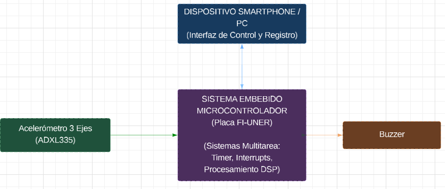
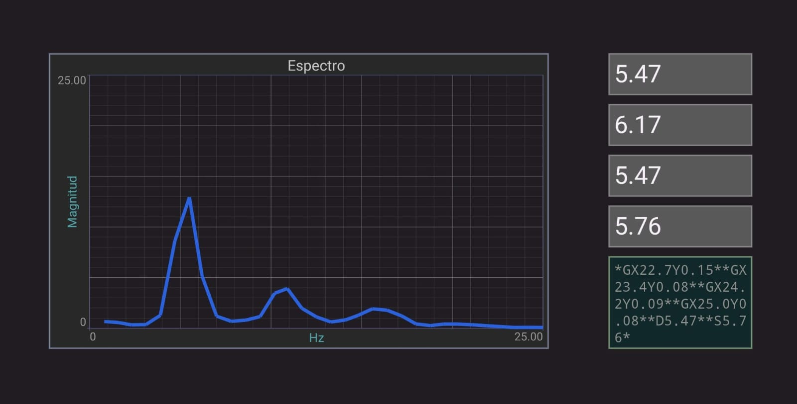
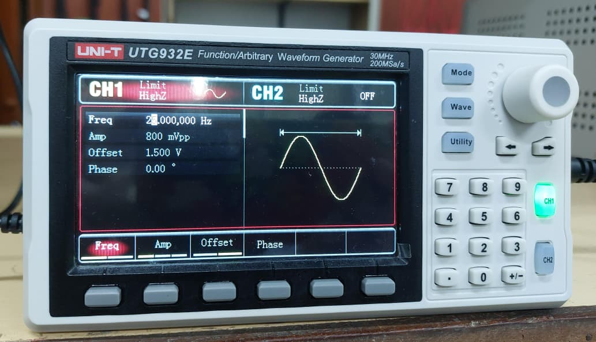
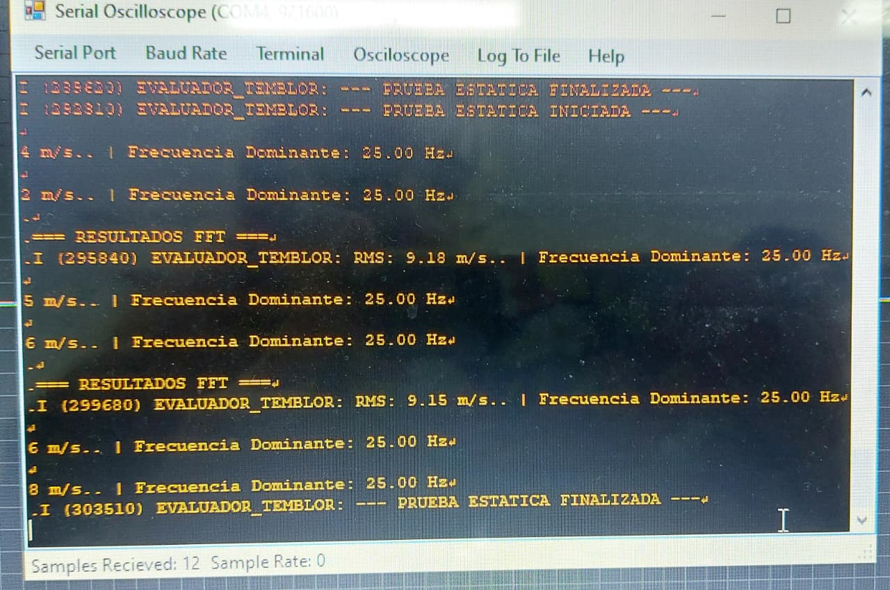
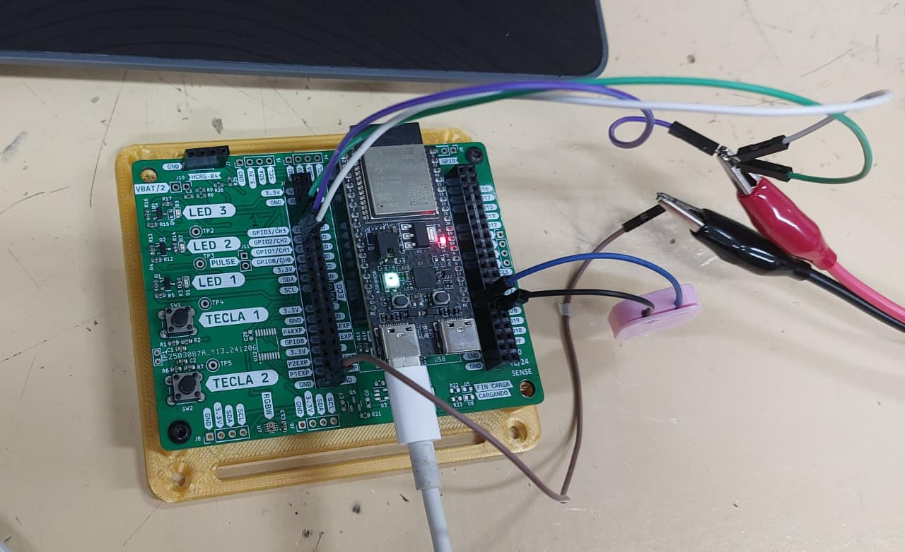
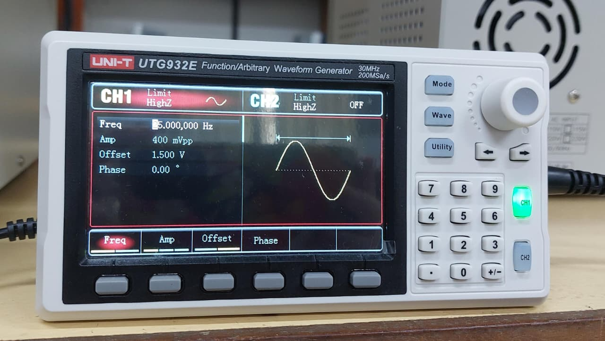
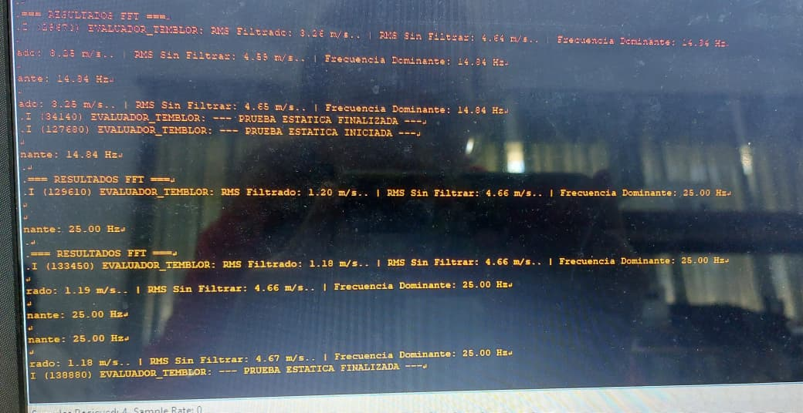
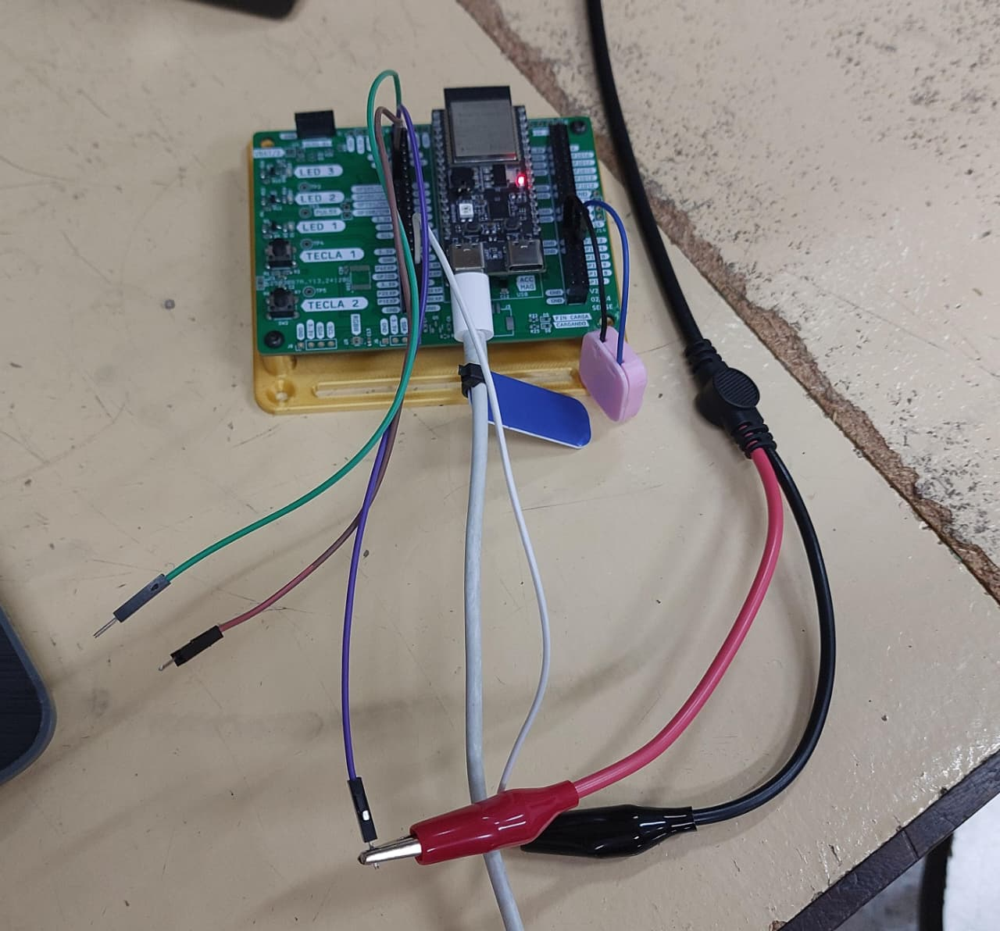

# Evaluador de Temblor Neuromuscular y Apraxia

Este proyecto consiste en un sistema embebido basado en el microcontrolador **ESP32** para la adquisición, filtrado digital, procesamiento espectral (FFT) y cuantificación del temblor neuromuscular (postural y cinético). 

El dispositivo evalúa la severidad y frecuencia del temblor mediante el cálculo del valor eficaz (**RMS**) de la aceleración y la detección de la **frecuencia dominante**, transmitiendo los resultados en tiempo real vía **UART** (PC) y **Bluetooth SPP** (BLE) hacia una aplicación gráfica.

---

## 🚀 Características Principales

* **Adquisición Triaxial:** Muestreo a $100\text{ Hz}$ de los ejes X, Y y Z del acelerómetro analógico **ADXL335** mediante temporizadores por hardware (`TimerInit`).
* **Cálculo del Módulo Vectorial:** Computa el módulo de la aceleración $\vert{}\vec{a}\vert{} = \sqrt{a_x^2 + a_y^2 + a_z^2}$ en $\text{m/s}^2$ para independencia de la orientación del sensor.
* **Filtrado Digital IIR (2.º orden):**
  * **Pasa Altas ($1\text{ Hz}$):** Remueve la componente continua (gravedad) y la deriva lenta del movimiento voluntario.
  * **Pasa Bajas ($15\text{ Hz}$):** Atenúa el ruido térmico y movimientos de alta frecuencia ajenos al temblor patológico.
* **Procesamiento Espectral (FFT):** Ventanas de $128$ muestras ($1.28\text{ s}$ por bloque, resolución de $0.78\text{ Hz}$) para obtener la magnitud del espectro de frecuencias hasta Nyquist ($50\text{ Hz}$).
* **Integración BLE / UART:** Transmisión de tramas formateadas (`*GX...Y...*`, `*R...*`, `*F...*`) para renderizado dinámico en apps móviles o herramientas como Serial Oscilloscope.
* **Interfaz de Usuario Basada en FreeRTOS:** Control de pruebas estáticas y dinámicas mediante interrupciones de botones (Switches) y alertas sonoras parametrizadas (Buzzer).

---

## Diagrama en Bloques



---

## 🛠️ Conexión de Hardware

| Periférico | Pin Componente | ESP32 (GPIO / Canal ADC) |
| :--- | :---: | :---: |
| **ADXL335** | Eje X | ADC CH0 |
| **ADXL335** | Eje Y | ADC CH1 |
| **ADXL335** | Eje Z | ADC CH2 |
| **Switch 1 (Prueba Estática)** | SW1 | GPIO_4 |
| **Switch 2 (Prueba Dinámica)** | SW2 | GPIO_15 |
| **Buzzer** | BZ1 | GPIO_20 |

---

## 💻 Instrucciones de Uso

### 1. Requisitos Previos
* **Herramientas de Software:** ESP-IDF v4.x / v5.x o Visual Studio Code con extensión ESP-IDF / PlatformIO.
* **Monitoreo Serie:** Software *Serial Oscilloscope* o terminal serie configurada a **921600 baudios**.
* **Aplicación Móvil:** Cualquier cliente Bluetooth Serial (SPP) compatible para recibir tramas BLE (dispositivo visible como `EVALUADOR_TEMBLOR_BLE`).

### 2. Flujo de Operación
1. Encender el ESP32 y verificar inicialización en la terminal serie (`ADXL335 inicializado con éxito.`).
2. **Prueba Estática:**
   * Presionar **Switch 1**. El sistema emitirá un beep corto.
   * Mantener el sensor estático/postural durante 10 segundos.
   * Al finalizar los 10 s, suena un beep largo y se envía el espectro promedio junto con el RMS total y la Frecuencia Dominante.
3. **Prueba Dinámica:**
   * Presionar **Switch 2**. El sistema emitirá un beep corto.
   * Realizar el movimiento cinético guiado durante 10 segundos.
   * Al finalizar, el buzzer emite el tono de cierre y se transmiten los resultados finales.

---

## 📱 Visualización del Resultado Final (Interfaz BLE Móvil)

Al finalizar cada prueba (estática o dinámica), el dispositivo envía el paquete de datos consolidado a través del perfil Bluetooth SPP. La aplicación móvil procesa las tramas transmitidas (`*GC*`, `*GX...Y...*`, `*D...*` y `*S...*`) para desplegar la gráfica del espectro promedio acumulado y los parámetros diagnósticos finales.



*Figura 1: Pantalla de la aplicación móvil mostrando el espectro de magnitudes promediado, la Frecuencia Dominante o de pico ($Hz$) y el valor RMS ($m/s^2$) de la ultima medición realizada, la Frecuencia Dominante ($Hz$) promediada a lo largo de toda la prueba (promedio de picos mayores) y el valor RMS ($m/s^2$) promediado (en ese orden).*

En este caso la frecuencia máxima de la ultima medición coincide con la frecuencia máxima de la prueba, aun asi el indicador para la evaluacion clinica es la frecuencia promediada.
Además de el pico de frecuencia máxima se observan otros picos secundarios de armonicos de la señal, pero en este caso el foco esta en la frecuencia dominante.

---

## 📊 Validación experimental y Pruebas de Funcionamiento

Para validar la precisión del sistema en la estimación de la **Frecuencia Dominante** y el **RMS**, se inyectaron señales senoidales conocidas mediante un **generador de funciones**.

### 1. Validación de Frecuencia Dominante
Se inyectaron señales senoidales de frecuencia conocida dentro del rango de temblor ($1\text{ Hz} - 15\text{ Hz}$). En la interfaz gráfica y en el plotter serie se verificó la coincidencia exacta entre la frecuencia introducida y el pico máximo detectado por la FFT.



*Figura 2: Generador con senoidal utilizada.*



*Figura 3: Salida en la terminal del espectro de magnitud de la FFT mostrando el valor de frecuencia dominante coincidente con la frecuencia del generador.*



*Figura 4: Conexión de la placa.*

### 2. Validación de Amplitud y RMS
Se comparó el cálculo del RMS del código contra el valor teórico ($V_{RMS} = \frac{V_{pico}}{\sqrt{2}}$) e instrumental del generador, confirmando que tras el filtrado IIR la severidad estimada refleja fielmente la amplitud real de la oscilación.



*Figura 5: Generador con senoidal utilizada.*



*Figura 6: Salida en la terminal del espectro de magnitud de la FFT mostrando el valor de frecuencia dominante, el RMS filtrado y el RMS sin filtrar.*



*Figura 7: Conexión de la placa.*

---
### 3. Video de Funcionamiento
Se observa la realización de la prueba estática, el procesamiento de las tramas en la aplicación movil, el envio de resultados finales a la terminal de la PC y la visualización del espectro y valores finales en la aplicación y la PC.

<video src="https://github.com/MiaSapetti/EProgramable_FIUNER_Sapetti_2C_2026/raw/main/firmware/projects/Proyecto_Integrador/imagenes/Video_Funcionamiento.mp4" controls="controls" style="max-width: 730px;">
</video>

*(Si el reproductor no carga en tu navegador, puedes [descargar o ver el video directamente aquí](imagenes/Video_Funcionamiento.mp4)).*

---
## 📁 Estructura del Proyecto

```text
.
├── main/
│   ├── main.c                # Código fuente principal con tareas FreeRTOS
│   └── CMakeLists.txt
├── drivers/                  # Librerías de la cátedra (ADXL335, FFT, IIR Filter, BLE, UART)
├── imagenes/                 # Capturas y diagramas del proyecto
└── README.md